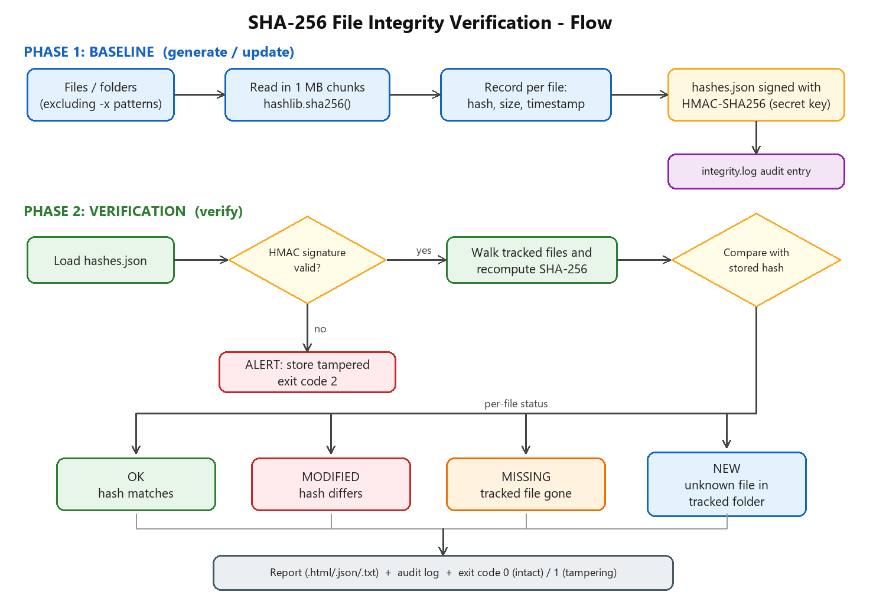
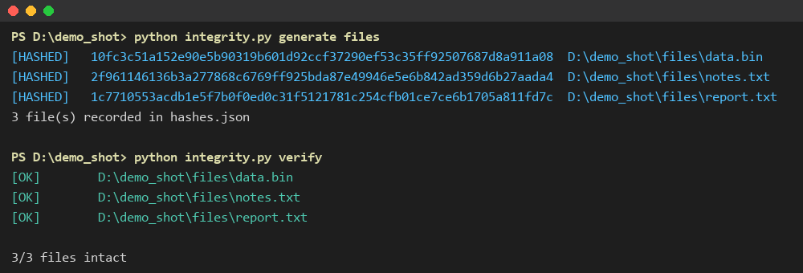
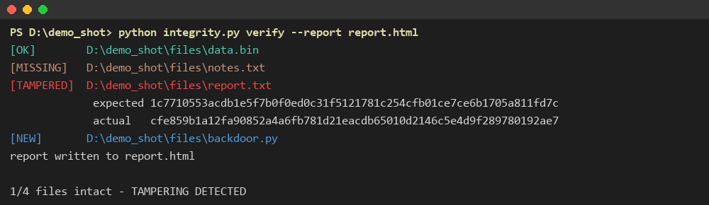
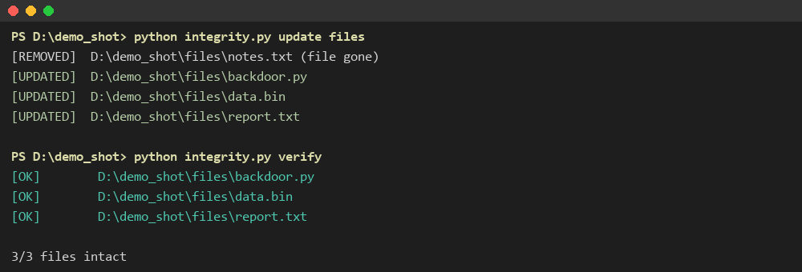
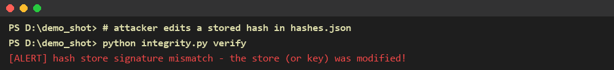
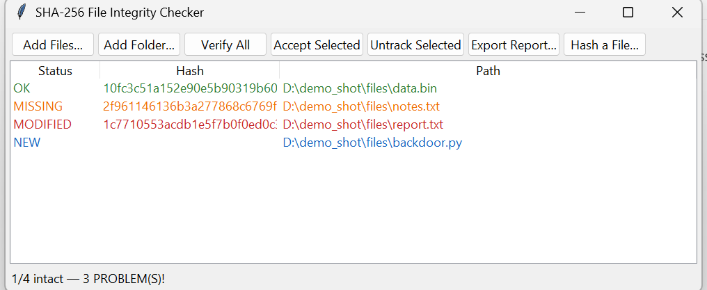
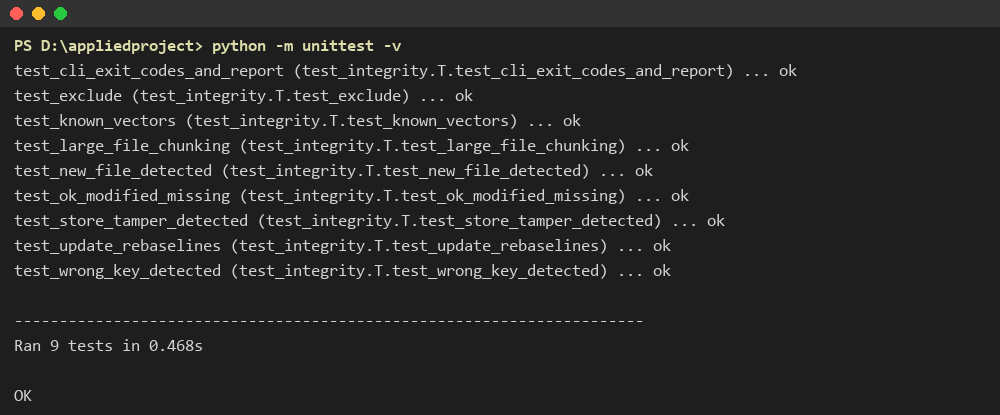

# Project Report: SHA-256 Based File Integrity Verification System

## 1. Objective
Verify file integrity and detect unauthorised modification using the SHA-256 cryptographic hash function.

## 2. Requirements
- **Hardware:** PC / laptop
- **Software:** Python 3, `hashlib` (standard library only; Tkinter for the optional GUI)

## 3. Background
SHA-256 maps any input to a fixed 256-bit digest. It is deterministic, collision-resistant and shows the avalanche effect: changing a single bit of a file produces a completely different digest. Comparing a stored digest with a freshly computed one therefore reveals any change to the file.

## 4. Design
| Module | Purpose |
|---|---|
| `integrity.py` | Core library and command-line interface |
| `gui.py` | Tkinter graphical interface |
| `demo.py` | Scripted demonstration of each attack scenario |
| `test_integrity.py` | Unit tests (9 cases) |

**Workflow:** `generate` creates a baseline of hashes → `verify` recomputes and compares → `update` accepts authorised changes → every action is written to `integrity.log`.



## 5. Implementation of Project Tasks
| Task | Implementation |
|---|---|
| Hash generation | `sha256_file()` reads files in 1 MB chunks via `hashlib.sha256`, so large files use constant memory. Directories are walked recursively; patterns can be excluded. |
| Integrity checking | `verify()` recomputes each hash and compares it with the stored value using constant-time `hmac.compare_digest`. |
| Tampering detection | Each file is reported as `OK`, `MODIFIED`, `MISSING`, `NEW` (unauthorised file in a tracked folder) or `UNKNOWN`. Exit code 1 signals tampering. |
| Hash storage | `hashes.json` stores hash, size and timestamp per file. It is written atomically with owner-only permissions and signed with HMAC-SHA256. |
| Security verification | Editing the store, or replacing the key, fails the HMAC check (exit code 2, logged as `ALERT`). Demonstrated in `demo.py` and the tests. |

## 6. Security Considerations
- A plain hash list can be altered by an attacker together with the tampered file. Signing the store with a secret key (`INTEGRITY_KEY` or `.integrity.key`) closes this gap; the key should be kept separate from the store.
- Baselines must be generated from a trusted state; earlier tampering cannot be detected.
- The tool detects changes but does not prevent them or restore files.

## 7. Results
| Test scenario | Outcome |
|---|---|
| NIST vector `SHA-256("abc")` | Matches `ba7816bf...15ad` |
| Unmodified files | `OK` |
| One-character / one-bit change | `MODIFIED` (digest differs entirely) |
| Deleted file | `MISSING` |
| New file in tracked folder | `NEW` |
| Authorised change then `update` | `OK` |
| Hash store edited by attacker | Detected (signature mismatch) |
| Wrong HMAC key | Detected |

All 9 unit tests and the demonstration script pass.

### Screenshots
**Baseline creation and clean verification**


**Tampering detected** (modified file, deleted file, unauthorised new file; HTML report: [docs/report_sample.html](docs/report_sample.html))


**Accepting authorised changes with `update`**


**Hash store tampering detected (HMAC check)**


**Graphical interface**


**Unit tests**


## 8. Usage
```
python integrity.py generate <folder>      # create baseline
python integrity.py verify                 # check integrity
python integrity.py update <path>          # accept authorised change
python gui.py                              # GUI
python demo.py                             # demonstration
python -m unittest -v                      # tests
```

## 9. Conclusion
The system generates, stores and verifies SHA-256 hashes, detects modified, deleted and added files, and protects its own hash database against tampering. Possible extensions: scheduled scans, email alerts, and storing the key or signature on separate media.
